# Fluxo de valor (rascunho)

**Status:** rascunho para o time revisar. **Corte da medição:** 2026-11-23 19:00 UTC.
**Reproduzir:** `node docs/rascunhos/metricas-entrega.mjs`.
**Marcadores:** [fato] é tempo ou contagem medido no GitHub. [estimativa] é interpretação
aproximada a partir desses dados.

## O caminho de uma mudança

```mermaid
flowchart LR
  A[Issue criada] -->|espera| B[Primeiro commit]
  B -->|desenvolvimento| C[PR aberto]
  C -->|rascunho, quando houver| R[Pronto para revisão]
  R -->|fila de revisão| D[Primeira revisão humana]
  D -->|ajustes e aprovação| E[Merge na main]
  E -.->|etapa ainda não existe| F[Produção]
```

## Tempo em cada etapa (PRs mesclados, projeto inteiro)

Todos os valores desta tabela são [fato].

| Etapa | n | Mediana | Média | Mínimo | Máximo |
|---|---|---|---|---|---|
| Espera: issue criada até o primeiro commit | 10 | 30,8 dias | 26,5 dias | 4 min | 64,6 dias |
| Desenvolvimento: primeiro commit até abrir o PR | 17 | 3 min | 56 min | 0 min | 12,7 h |
| Fila: pronto para revisão até a primeira revisão humana | 14 | 4,7 h | 1,3 dia | 1 min | 6,8 dias |
| Revisão até o merge | 14 | 33 min | 16,6 h | 0 min | 4,7 dias |
| Merge até produção | 0 | sem dado | sem dado | sem dado | sem dado |

A fila começa no evento `ready_for_review` quando ele existe; senão, na abertura do PR. Contas de
bot da lista do script não contam como revisão humana. Os PRs #22, #24 e #25 foram mesclados sem
revisão humana registrada [fato].

## Como ler com cuidado

- **As etapas não somam.** Cada uma tem seu próprio n, e soma de medianas não dá a mediana do
  total.
- **O desenvolvimento aparece menor do que foi.** O relógio começa no primeiro commit. Trabalho
  local antes dele não é visível, e a mediana de 3 min [fato] sugere que boa parte do trabalho
  já estava pronta quando o primeiro commit foi feito [estimativa].
- **A espera inclui backlog planejado.** Parte dela é ordem de prioridade e não desperdício
  [estimativa].

## Situação dos PRs no corte

| PR | Situação [fato] | Aberto há [fato] | Fila de revisão [fato] | Aprovação [fato] |
|---|---|---|---|---|
| #50 | pronto | 5,1 dias | sem revisão humana há 5,1 dias | nenhuma |
| #51 | pronto | 5,1 dias | 4,9 dias | ChisSilva |
| #52 | pronto | 5,1 dias | 1 min desde `ready_for_review` em 2026-11-23 | ChisSilva |
| #53 | rascunho | 4,5 dias | fora da fila | ChisSilva |
| #54 | rascunho | 4,5 dias | fora da fila | ChisSilva |

- WIP em revisão: 3 PRs prontos, com limite de 2 no acordo [fato].
- Prazo de 24 h nos PRs prontos abertos desde 2026-11-01 (#49 a #52): 1 dentro (#52) e 3 fora
  (#49 com 2,0 dias, #51 com 4,9 dias, #50 ainda sem revisão) [fato].
- Só o #49 foi mesclado na Sprint 2 até o corte [fato].
- Gargalo mais provável na reta final: **integração**, com quatro PRs aprovados ainda sem merge e
  o #50 sem revisão, a 7 dias da entrega [estimativa].

## Perguntas para o time

- [ ] Qual a ordem de merge de #50 a #54, considerando que #52 e #54 alteram `api/package.json`?
- [ ] Quem revisa o #50?
- [ ] #53 e #54 saem de rascunho antes da entrega?
- [ ] A entrega final terá implantação? Se sim, quem faz e em que data?
