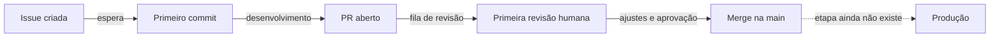

# Fluxo de valor (rascunho)

**Status:** rascunho para o time revisar. **Corte da medição:** 2026-11-23 19:00 UTC.
**Reproduzir:** `node docs/rascunhos/metricas-entrega.mjs` (seção "Fluxo de valor").
**Marcadores:** [fato] é tempo ou contagem lido do git ou da API do GitHub. [estimativa] é
interpretação aproximada a partir desses dados.

## O caminho de uma mudança

## Tempo em cada etapa (PRs mesclados, projeto inteiro)

| Etapa | n | Mediana | Média | Mínimo | Máximo |
|---|---|---|---|---|---|
| Espera: issue criada até o primeiro commit | 10 | 30,8 dias [fato] | 26,5 dias [fato] | 4 min [fato] | 64,6 dias [fato] |
| Desenvolvimento: primeiro commit até abrir o PR | 17 | 3 min [fato] | 56 min [fato] | 0 min [fato] | 12,7 h [fato] |
| Fila: abrir o PR até a primeira revisão humana | 14 | 4,7 h [fato] | 1,7 dia [fato] | 1 min [fato] | 7,0 dias [fato] |
| Revisão até o merge | 14 | 33 min [fato] | 16,6 h [fato] | 0 min [fato] | 4,7 dias [fato] |
| Merge até produção | 0 | sem dado | sem dado | sem dado | sem dado |

Revisões do Copilot não contam como revisão humana. Os PRs #22, #24 e #25 foram mesclados sem
revisão humana registrada [fato], antes da proteção da `main`.

## Como ler com cuidado

- **As etapas não somam.** Cada uma tem seu próprio n, e soma de medianas não dá a mediana do
  total.
- **O desenvolvimento aparece menor do que foi.** O relógio começa no primeiro commit. Trabalho
  local antes dele não é visível, e a mediana de 3 min [fato] sugere que boa parte do trabalho
  já estava pronta quando o primeiro commit foi feito [estimativa].
- **A espera inclui backlog planejado.** Várias histórias foram criadas juntas no planejamento de
  2026-09-10, então parte da espera é ordem de prioridade e não desperdício [estimativa].

## Onde o fluxo trava agora

| PR | Situação no corte | Aberto há | Primeira revisão humana |
|---|---|---|---|
| #50 | pronto | 5,1 dias [fato] | ainda não houve [fato] |
| #51 | pronto | 5,1 dias [fato] | em 4,9 dias [fato] |
| #52 | pronto | 5,1 dias [fato] | em 4,9 dias [fato] |
| #53 | rascunho | 4,5 dias [fato] | em 4,4 dias [fato] |
| #54 | rascunho | 4,5 dias [fato] | em 4,4 dias [fato] |

- WIP em revisão: 3 PRs prontos, com limite de 2 no acordo [fato].
- O #49, único merge da Sprint 2 até o corte, recebeu a primeira revisão humana 7,0 dias depois
  de aberto e foi mesclado no mesmo minuto [fato].
- Gargalo mais provável na reta final: **revisão e integração**, com cinco PRs abertos a 7 dias
  da entrega [estimativa].

## Perguntas para o time

- [ ] Qual a ordem de merge de #50 a #54, considerando que #52 e #54 alteram `api/package.json`?
- [ ] Quem revisa o #50, que ainda não teve revisão humana?
- [ ] A entrega final terá implantação? Se sim, quem faz e em que data?
